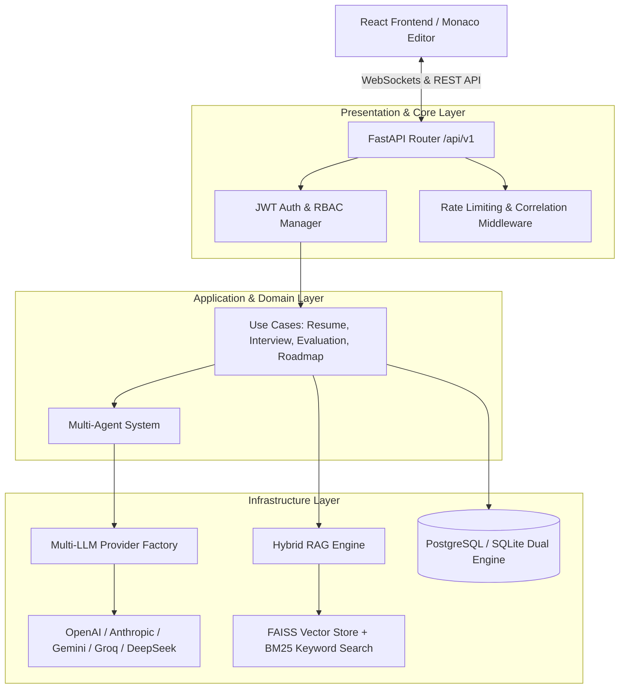

<div align="center">

# 🚀 Enterprise AI Interview Assistant

### Production-Grade Full-Stack AI Platform for Real-Time Voice & Coding Interviews

[](https://www.python.org/)
[](https://fastapi.tiangolo.com/)
[](https://reactjs.org/)
[](https://python.langchain.com/)
[](https://github.com/facebookresearch/faiss)
[](https://www.docker.com/)
[](LICENSE)

</div>

---

## 📌 Executive Overview

**AI Interview Assistant** is an enterprise-grade, full-stack AI SaaS platform designed to automate and elevate candidate technical evaluations. Engineered following **Clean Architecture**, **Domain-Driven Design (DDD)**, and **SOLID principles**, the platform conducts real-time voice and interactive coding interviews featuring automated ATS resume parsing, multi-agent AI scoring, hybrid Retrieval-Augmented Generation (RAG), and personalized learning roadmap synthesis.

---

## ✨ Key Platform Features

### 🤖 1. Multi-Agent AI System
Deploys specialized AI agents working in concert to evaluate candidates:
- **Resume Analysis Agent**: Extracts candidate metadata, computes ATS match scores (0–100%), evaluates confidence ratings, and pinpoints technical skill gaps.
- **Planning Agent**: Constructs adaptive interview question trees tailored to experience tiers (*Junior*, *Mid*, *Senior*, *Staff*, *Principal*).
- **Technical & System Design Agent**: Evaluates architectural trade-offs, concurrency patterns, and distributed system principles.
- **Code Review Agent**: Performs automated line-by-line code analysis, calculates **Big-O** time and space complexity, and scans for security vulnerabilities.
- **Evaluation & Synthesis Agent**: Aggregates multi-agent metrics into an executive assessment report.
- **Roadmap Agent**: Converts candidate growth areas into actionable, milestone-based learning paths.

### 🔌 2. Unified Multi-LLM Provider Engine
Swap LLM providers seamlessly via environment configuration without modifying application logic:
- 🟢 **OpenAI** (`gpt-4o`)
- 🟣 **Anthropic** (`claude-3-5-sonnet`)
- 🔵 **Google Gemini** (`gemini-1-5-pro`)
- ⚡ **Groq** (`llama-3-70b` ultra-low latency)
- 🧠 **DeepSeek** (`deepseek-r1` reasoning model)
- 🦙 **Ollama** (Self-hosted local models)

### 🧠 3. Hybrid RAG System (LangChain + FAISS + BM25)
- **Dense Retrieval**: FAISS vector indexing for high-dimensional semantic search over technical domain benchmarks.
- **Sparse Lexical Search**: BM25 keyword matching to preserve exact technical terms and acronyms.
- **Cross-Encoder Re-ranking**: Scores top-retrieved context passages to eliminate hallucination risks.

### 🎙️ 4. Real-time Voice & Monaco Coding Studio
- **Voice AI Avatar**: Web Speech API **Text-to-Speech (TTS)** voice synthesis reading questions aloud with live animated audio visualizers.
- **Speech-to-Text (STT)**: Real-time candidate voice transcription.
- **Integrated Monaco Code Editor**: Multi-language support (*Python*, *JavaScript*, *C++*, *SQL*, *Go*), built-in test case runner, and AI diff review drawer.
- **WebSockets Manager**: Dual real-time streaming for live code sync, timer updates, and instant score notifications.

### 📊 5. Executive Analytics & Personalized Roadmaps
- **Executive Scorecard**: Overall score breakdowns across *Technical Accuracy*, *Problem Solving*, *Communication*, and *Code Quality*.
- **Executive PDF Export**: Single-click PDF report generation.
- **Personalized Skill Roadmap**: Interactive milestone timeline complete with recommended projects, study hours, and resource documentation links.

---

## 🏗️ System Architecture



---

## 📁 Repository Clean Architecture

```
AI-Interview-Assistant/
├── backend/
│   ├── core/
│   │   ├── config/          # Pydantic environment settings & provider configs
│   │   ├── security/        # JWT authentication, bcrypt hashing, RBAC permissions
│   │   ├── middleware/      # Rate limiters, security headers, correlation IDs
│   │   └── exceptions/      # Standardized domain error handlers
│   ├── domain/
│   │   ├── entities/        # Core domain models (Candidate, Session, Question, Evaluation)
│   │   ├── value_objects/   # Immutable value objects (ScoreBreakdown, ATSReport)
│   │   └── repositories/    # Abstract repository interfaces
│   ├── application/
│   │   ├── use_cases/       # Business logic implementations
│   │   └── dto/             # Data Transfer Objects
│   ├── infrastructure/
│   │   ├── llm/             # Multi-LLM provider abstraction & Multi-Agent implementations
│   │   ├── vector_store/    # Hybrid RAG engine (FAISS + BM25 + Cross-Encoder)
│   │   ├── database/        # Async SQLAlchemy 2.0 connection pooling & models
│   │   └── messaging/       # Real-time WebSocket connection manager
│   ├── presentation/
│   │   └── api/v1/          # Versioned REST routers (auth, resume, interview, evaluation, ws)
│   └── main.py              # FastAPI application entry point
│
├── frontend/
│   ├── src/
│   │   ├── components/      # React components (Navbar, ResumeUpload, CodeEditor, InterviewStudio, EvaluationDashboard, RoadmapView)
│   │   ├── App.jsx          # Main application router & state controller
│   │   └── index.css        # Jet Black Enterprise SaaS Design System
│   ├── package.json
│   └── vite.config.js
│
├── Dockerfile.backend       # Multi-stage Python 3.12 build
├── Dockerfile.frontend      # Multi-stage Node build with Nginx
└── docker-compose.yml       # Production orchestration (PostgreSQL + FastAPI + React)
```

---

## 🚀 Quick Start Guide

### Prerequisites
- **Python**: 3.12+
- **Node.js**: 20+ / 24+
- **Docker**: (Optional for containerized deployment)

---

### 1. Local Backend Setup (FastAPI)

```bash
# Navigate to backend directory
cd backend

# Create virtual environment
python -m venv venv

# Activate virtual environment
# Windows:
venv\Scripts\activate
# macOS/Linux:
source venv/bin/activate

# Install dependencies
pip install -r requirements.txt

# Start FastAPI application
python main.py
```
- **Backend API Base**: `http://localhost:8000`
- **Interactive OpenAPI Docs**: `http://localhost:8000/api/v1/docs`

---

### 2. Local Frontend Setup (React)

```bash
# Navigate to frontend directory
cd frontend

# Install dependencies
npm install

# Launch Vite development server
npm run dev
```
- **Web Application**: `http://localhost:3000`

---

### 3. Docker Compose Orchestration

To run the complete production environment (*PostgreSQL database*, *FastAPI backend*, and *React frontend*):

```bash
docker-compose up --build
```

- **Frontend App**: `http://localhost:3000`
- **FastAPI API**: `http://localhost:8000`
- **PostgreSQL**: `localhost:5432`

---

## ⚙️ Environment Variables

| Variable | Default Value | Description |
| :--- | :--- | :--- |
| `ENVIRONMENT` | `development` | Environment mode (`development` or `production`) |
| `SECRET_KEY` | `super-secret-key` | JWT signature key |
| `DATABASE_URL` | `postgresql+asyncpg://...` | Primary PostgreSQL connection string |
| `SQLITE_URL` | `sqlite:///./interview_assistant.db` | Fallback local SQLite database |
| `DEFAULT_LLM_PROVIDER` | `openai` | Selected LLM provider (`openai`, `anthropic`, `gemini`, `groq`, `deepseek`, `ollama`) |
| `OPENAI_API_KEY` | `""` | OpenAI API key |
| `ANTHROPIC_API_KEY` | `""` | Anthropic API key |
| `GEMINI_API_KEY` | `""` | Google Gemini API key |
| `GROQ_API_KEY` | `""` | Groq API key |

---

## 📜 License

This project is licensed under the MIT License - see the [LICENSE](LICENSE) file for details.

---

<div align="center">
  <sub>Built with ❤️ by Isha for modern AI-driven technical assessments.</sub>
</div>
